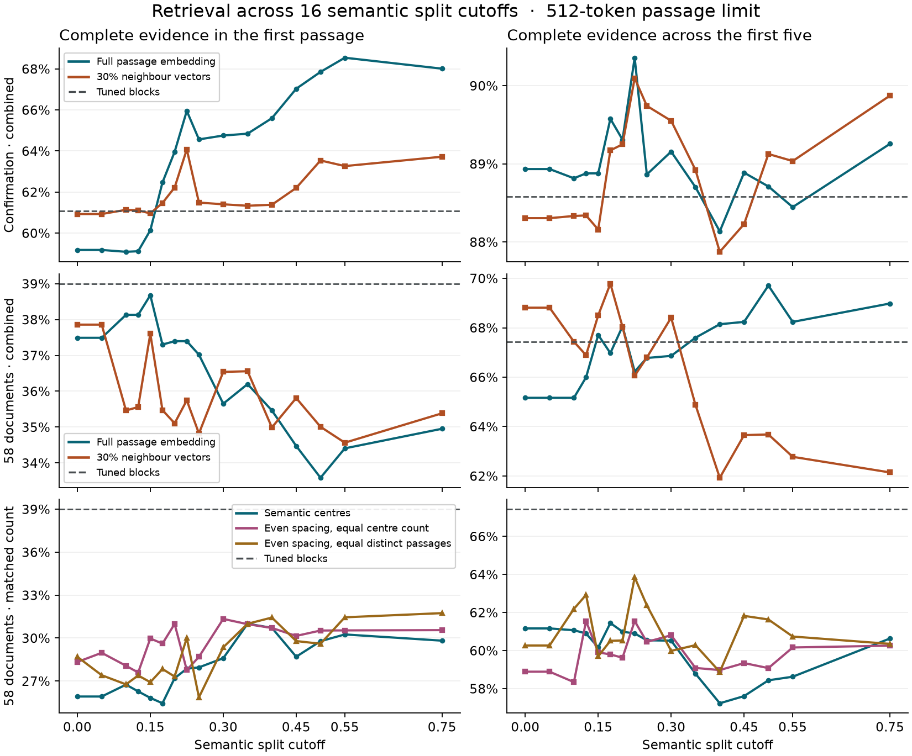

# Does semantic placement improve retrieval at the same passage count?

An intermediate cutoff did beat both 0.15 and 0.55 on confirmation. The strongest sign of a broadly useful semantic algorithm came from using a contained semantic match to rank an ordinary structural passage. One such setting beat independently tuned blocks on both coverage measures in all five validation searches. It lost on development and on individual domains. The matched placement experiment found that ordinary passage density could account for the newer shared search's first-hit gain from strict splitting. [Full curves and paired intervals](2026-11-27-passage-placement.json.gz)

## Where an intermediate cutoff wins

The earlier wide sweep tested one neighbouring chunk per side. Its follow-up gave the reader the full 512-token budget at only 0.15 and 0.55. This experiment fills that gap. Each cell gives the percentage of questions with complete evidence **first / across the first five**. The structural candidates, reading limit and neighbour weight stay fixed down each column. The newer shared search asks 468 questions across 58 documents. Confirmation contains 807 questions across seven domains.

| Cutoff | Confirmation, 30% neighbours | New shared, 30% neighbours | New shared, full passage embedding |
|---:|---:|---:|---:|
| 0.00 | 60.9 / 88.3 | 37.9 / 68.8 | 37.5 / 65.2 |
| 0.05 | 60.9 / 88.3 | 37.9 / 68.8 | 37.5 / 65.2 |
| 0.10 | 61.1 / 88.3 | 35.5 / 67.4 | 38.1 / 65.2 |
| 0.125 | 61.1 / 88.3 | 35.6 / 66.9 | 38.1 / 66.0 |
| 0.15 | 61.0 / 88.2 | 37.6 / 68.5 | 38.7 / 67.7 |
| 0.175 | 61.5 / 89.2 | 35.5 / 69.8 | 37.3 / 67.0 |
| 0.20 | 62.2 / 89.2 | 35.1 / 68.0 | 37.4 / 68.1 |
| 0.225 | 64.1 / 90.1 | 35.7 / 66.1 | 37.4 / 66.2 |
| 0.25 | 61.5 / 89.7 | 34.8 / 66.8 | 37.0 / 66.8 |
| 0.30 | 61.4 / 89.6 | 36.5 / 68.4 | 35.7 / 66.9 |
| 0.35 | 61.3 / 88.9 | 36.6 / 64.9 | 36.2 / 67.6 |
| 0.40 | 61.4 / 87.9 | 35.0 / 61.9 | 35.5 / 68.1 |
| 0.45 | 62.2 / 88.2 | 35.8 / 63.7 | 34.5 / 68.2 |
| 0.50 | 63.5 / 89.1 | 35.0 / 63.7 | 33.6 / 69.7 |
| 0.55 | 63.3 / 89.0 | 34.6 / 62.8 | 34.4 / 68.2 |
| 0.75 | 63.7 / 89.9 | 35.4 / 62.1 | 35.0 / 69.0 |

With the 30% blend, confirmation peaked on both measures at 0.225 over the 0.15–0.55 interval. Its paired gains over 0.15 were +3.1 points first and +1.9 within five. The source-bootstrap 95% intervals were −0.3 to +6.5 and −0.1 to +3.9. On the newer known-source questions, moving from 0.15 to 0.225 **cost 4.1 points within five**, with an interval of −7.3 to −1.2. On the newer pooled search, 0.175 gave the best within-five score with the blend, while 0.50 gave the best within-five score with whole-passage embeddings. Neither also gave the best first hit for its ranking method.



## How much does the position of the centre matter?

From 0.15 to 0.55, the 58 newer documents went from **1,899 to 9,014 centres**. With semantic placement, complete first hits rose from 25.8% to 30.3% in the common-window experiment, a gain of 4.43 points. Ordinary evenly spaced passages given the same number of **distinct windows per section** gained 4.53 points. That leaves −0.10 points attributable to the change in placement under this control, with a paired 95% interval of −3.86 to +3.55. Within five, semantic placement lost 1.54 points while the distinct-window control gained 1.04. The difference in changes was −2.57 points, with an interval of −6.58 to +1.57.

At 0.55, 4,467 of the 4,880 distinct semantic windows also appeared in the equal-centre-count evenly spaced index. At 0.15, only 773 of 1,646 did. The stricter setting gives both methods more opportunities to centre a passage near an answer and makes their candidate sets increasingly similar. The mean distance from the native semantic midpoint to its matched parser unit was 7.5 tokens at 0.15 and 2.8 at 0.55. Median displayed lengths were 500 and 501 tokens in these two matched comparisons.

| At cutoff 0.55 | Semantic centres | Even spacing, same centre count | Even spacing, same distinct-window count |
|---|---:|---:|---:|
| Development | 41.5 / 70.7 | 39.4 / 69.6 | 40.8 / 69.7 |
| Confirmation | 55.0 / 87.2 | 52.1 / 85.4 | 52.2 / 87.2 |
| Replication, original pools | 64.9 / 92.6 | 62.3 / 92.6 | 66.1 / 91.4 |
| Replication, all 69 sources | 60.8 / 86.3 | 58.2 / 86.2 | 62.1 / 85.2 |
| New documents, known source | 43.3 / 73.5 | 44.9 / 74.7 | 45.5 / 75.4 |
| New documents, all 58 sources | 30.3 / 58.6 | 30.5 / 60.2 | 31.5 / 60.7 |

The ordinary controls won both measures on the newer shared search at 0.55. Against the equal-distinct-window control the semantic differences were −1.2 points first (95% interval −3.2 to +0.9) and −2.1 within five (−4.3 to −0.3). Semantic placement did help first on confirmation. On the older replication it led first against equal centre count and trailed first against equal distinct-window count. These comparisons use the same literal window cosine on both sides. The complete hierarchical indexes also score paragraphs and sections, so they have a different absolute level of accuracy.

## Can semantic retrieval beat tuned blocks across searches?

Of 403 evaluated settings and controls, **one** beat tuned blocks on both aggregate coverage measures in all five validation search conditions. It used a **0.175** split cutoff. It kept the tuned structural passages as the returned results and gave **half the ranking score** to the best wholly contained semantic child's contextualised score. That score includes the actual embedding of the child with eligible immediate neighbours, plus the paragraph and section terms. The other half comes from the structural passage's existing score. A parent without a contained child retains its original score.

This setting emerged from a retrospective comparison of the validation results. Development had selected a 0.45 cutoff and a 15% child weight for this family. Each of the two replications uses its questions twice, under different search scopes. The five validation comparisons include three distinct question sets.

| Search | Tuned blocks | Development choice, 0.45 and 15% child | Retrospective choice, 0.175 and 50% child | Guarded expansion |
|---|---:|---:|---:|---:|
| Development | 54.7 / 82.2 | 55.1 / 83.1 | 49.9 / 79.0 | 54.7 / 82.2 |
| Confirmation | 61.1 / 88.6 | 60.7 / 89.4 | 62.2 / 90.6 | 61.6 / 89.6 |
| Replication, original pools | 71.0 / 93.4 | 70.9 / 94.5 | 74.1 / 94.5 | 72.2 / 93.4 |
| Replication, all 69 sources | 66.0 / 88.8 | 66.3 / 89.4 | 69.2 / 89.0 | 67.1 / 88.8 |
| New documents, known source | 54.3 / 82.7 | 56.5 / 82.8 | 54.5 / 82.8 | 54.5 / 82.7 |
| New documents, all 58 sources | 39.0 / 67.4 | 40.3 / 66.1 | 39.2 / 69.0 | 39.2 / 67.4 |

For the retrospective setting, all ten paired validation intervals for the two coverage differences include zero. Development lost 4.8 points first (95% interval −7.9 to −1.9) and 3.2 within five (−5.6 to +0.4). Even on the newer shared search, the gain from 39.0% to 39.2% first included 25 questions gaining complete first hits and 24 losing them. Within five it reached 69.0% against 67.4%. No setting strictly beat both the 256-token and independently tuned structural baselines in all validation searches. No freely reranked setting avoided every domain-level loss. The 0.175 parent score is a candidate to freeze on previously unseen sources. The results support keeping tuned blocks as the general default.

The guarded expansion preserved every previously complete first and top-five answer on every evaluated query. On the newer shared search it recovered two additional first hits and zero additional within-five answers. Evenly spaced expansion recovered one additional first hit. Average first-passage length rose from 434 to 454 tokens with semantic expansion, and citation F1 moved from 17.42% to 17.30%. Guarding the original answers buys a specific coverage guarantee. Here its extra yield was small.

## What the comparison measures

The first-hit measure asks whether the first passage contains the entire annotated answer evidence. The within-five measure allows that evidence to be spread across the five returned passages from the correct source. Citation F1 also accounts for extra text in the first passage. Every displayed passage fits 512 tokens. Each domain receives equal weight. Each query searches its entire assigned candidate pool, including score ties at the retrieval boundary. [Measures and citation review](2026-11-27-paragraph-ranking.md)

The native experiment changes the hierarchical split cutoff at 16 settings. A higher cutoff requires a closer semantic match to merge adjacent units. At each cutoff the reader can receive as much surrounding text as fits the budget and the section permits. One ranking embeds that ordered passage. Another mixes 70% of the core's unit vector with 30% of the mean unit vector of its eligible immediate neighbours, then normalises the result. Both keep the existing paragraph and enclosing-section scores. The combined index adds the same 256-token structural layout at every cutoff. Separate runs use the independently tuned 512-token structural layout alone, in a union with semantic passages, and as parents scored partly by their best contained contextualised semantic child. [Previous two-cutoff budget comparison](2026-11-27-neighbor-threshold.md)

The placement experiment builds one common set of passages from parser units. Each unit has a fixed, source-cited window that grows to the token budget inside its section or record. Each semantic core selects the nearest available unit to its token midpoint, in order. The comparison selects the same number of units at even token intervals in each section run. Both rank the literal embeddings of their selected windows and suppress duplicates at 85% source overlap. This isolates where a passage is centred under a common renderer and ranking rule. Native semantic ranking also uses the content and boundaries of the original core.

Additional controls address different ways that density might influence the result. Shifting the even spacing a quarter of a step earlier or later tests sensitivity to its starting position. Matching counts separately within 64-token passage-length bands controls for short sections and edges. A further comparison matches the number of **distinct returned windows** in each section, since several centres can render identical text. Even spacing across an entire document tests the additional benefit of how semantic splitting distributes its centres between sections. [Experiment protocol](../passage-placement-protocol.json)

The guarded comparison starts with the five independently tuned block hits in their original order. It can replace a hit with a larger same-source window only when that window includes every original source span, fits the same token ceiling and still passes duplicate suppression against the other hits. The query selects the highest-scoring eligible window. This preserves evidence already retrieved at each rank by construction. Precision, passage length and evidence gained are measured separately.

## Two questions about the same scene

At cutoff 0.30, both methods offered 48 centres in *Assipattle and the Mester Stoorworm*. One question asks what the sorcerer did when the king requested advice. The first semantic passage includes his promise to return the next day. The evenly spaced first hit ends just after the king asks for help. It misses the reply by a few words.

The next question asks **why the council found the advice horrifying**. Semantic retrieval returns exactly the same 499-token passage. Its last sentence describes the council's horror, which resembles the question closely. The reason appears in the next sentence, just outside the passage. An evenly spaced 505-token result reaches the sorcerer's demand and contains the complete answer. Changing the centre helped one question and hurt the other within a single scene, with the same passage count and essentially the same reading length. These are development examples.

## Reproduction

The four datasets contain 267 documents and 2,517 evaluation questions. They include fiction, spoken meetings, board minutes, research papers, financial filings, government documents and software FAQs. The newer cross-document search contains 24 stories, 24 papers and 10 meetings. The replication sets are each evaluated with their original source restrictions and with all documents pooled. They were used in earlier studies. The global settings for each retrieval family are chosen on development before evaluating confirmation and replication. Source-paired intervals resample documents 3,000 times within domains.

The experiment uses the prepared paragraph-ranking corpus and 1,536-dimensional `text-embedding-3-small` vectors. The index builder reuses cached vectors and embeds missing literal passages. Replication paper 1911.05652 had two historical vector snapshots for the same input. They put a boundary on opposite sides of 0.175. Replaying the paper's original split vectors at every cutoff recovered its archived chunks. The scorer checks the ordered top-five structural citations against the archive and reproduces the earlier full-budget measurements at 0.15 and 0.55. The plot requires Matplotlib. [Corpus preparation](2026-11-27-paragraph-ranking.md) · [Full scores, controls and intervals](2026-11-27-passage-placement.json.gz)

```sh
node benchmarks/neighbor-threshold-index.mjs --placement
python benchmarks/passage-placement.py development confirmation fresh shared-fresh holdout shared-holdout publish
python benchmarks/passage-placement-plot.py
```
