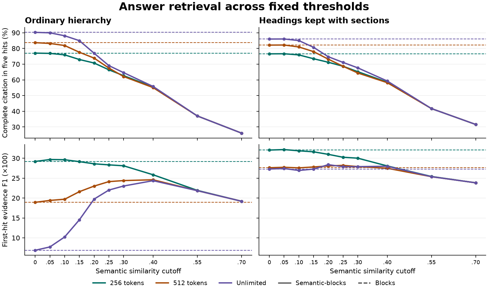

# Fixed semantic thresholds, section headings and prose retrieval

**A permissive cutoff helps with over-splitting. The more reliable improvement in passage focus came from respecting section headings.** Development selected .10 for both objectives. For first-hit focus it selected heading-aware semantic-blocks at 256 tokens. For complete citations in five hits it selected ordinary, unlimited semantic-blocks. Neither semantic choice beat the corresponding structural control on its selection metric on confirmation.

| Confirmation, four equally weighted domains | Complete first hit | Complete in five | First-hit evidence F1 × 100 |
|---|---:|---:|---:|
| Ordinary blocks, 256 | 49.97% | 77.02% | 29.19 |
| Ordinary semantic, 256, .10 | 48.62% | 75.91% | 29.62 |
| Headings with blocks, 256 | 49.12% | 76.55% | **32.06** |
| Headings with semantic, 256, .05 | 48.79% | 76.61% | 32.17 |
| Headings with semantic, 256, .10 | 47.61% | 75.89% | 31.87 |
| Headings with semantic, 256, .40 | 28.56% | 58.53% | 28.07 |
| Ordinary blocks, 512 | 51.88% | 83.68% | 18.92 |
| Headings with blocks, unlimited | 57.68% | 85.97% | 27.30 |
| Ordinary blocks, unlimited | **73.95%** | **90.22%** | 6.88 |
| Ordinary semantic, unlimited, .10 | 65.36% | 88.06% | 10.22 |

For the 256-token structural control, keeping headings with sections gained **2.87 points in focus**. A paired source-cluster bootstrap gives a descriptive 95% interval of **+1.45 to +4.54**. Complete-at-five fell 0.47 percentage points (−1.55 to +0.58). Adding .10 semantic cuts to that heading-aware structural control changed focus by −0.19 points (−0.68 to +0.23) and complete-at-five by −0.66 percentage points (−1.70 to +0.11). The simpler heading rule accounts for the improvement over ordinary blocks. [Full results and paired comparisons](2026-11-27-prose-threshold-results.json)

### How much can a threshold fix?

Accepting every scored merge at −1 reproduced the structural passages on **all 346 documents**, at every cap and with either heading treatment. Zero reproduced them on all 187 confirmation documents. At .05 with headings and a 256-token cap, only 16 of those 187 changed. The result was one extra complete top five among 740 questions. A student-aid citation moved from rank six to five. First-hit focus rose 0.11 points, while complete first hits fell 0.33 percentage points on the equal-domain average. This is the highest observed confirmation focus across the grid. Development had selected .10, and the observed .05 gain is too small to justify semantic splitting as a default.

At .10, the same heading treatment gained one complete top five and lost eight against blocks. **All eight losses had an intact citation somewhere in the structural index. In the semantic index none had a single passage left containing the complete citation.** All eight still retrieved some of the evidence in five hits. At .40 the tally was nine gains and 177 losses. In 121 of the losses, a previously intact citation had been split. In another 46 a complete semantic passage existed farther down the ranking. The remaining ten already required multiple structural hits. Both fragmenting an answer and ranking its fragments can cost a result.

The multi-sentence research questions show the effect directly. On the 79 confirmation questions whose unchanged reference spanned at least two prose units in every accepted answer, 256-token heading blocks covered 46 in five hits. Cutoffs .05 and .10 covered those same 46. At .40 they covered 27, losing 19 and gaining zero. On the 101 unchanged research questions whose reference could fit in one prose unit, .40 gained six and lost 20. Here a prose unit is a source sentence or similar parsed unit touching the citation. These groups exclude revised citations and those with no prose units.

A favorable threshold does exist for individual questions. Letting each confirmation question choose its own cutoff after seeing the answer would recover 13 paper questions and six government questions missed by heading-aware 256-token blocks. It would recover zero additional FAQ or finance questions. Those 19 cases are candidates for investigating which boundaries deserve context. Choosing a threshold this way is an upper bound and cannot be used at indexing time. [Per-domain counts, paired losses and unchanged paper citations](2026-11-27-prose-threshold-diagnostics.json)

### Which documents benefited?

| Confirmation domain | Questions | Complete in five, ordinary blocks 256 / heading blocks 256 / heading semantic 256 at .10 | First-hit F1 × 100, same order |
|---|---:|---:|---:|
| Research papers | 190 | 123 / 122 / 122 | 20.9 / 21.4 / 21.2 |
| Software FAQs | 76 | 74 / 74 / 73 | 49.9 / 57.4 / 57.7 |
| Government services | 449 | 386 / 380 / 374 | 27.1 / 30.7 / 29.9 |
| Financial prose | 25 | 15 / 15 / 15 | 18.7 / 18.7 / 18.7 |

Keeping manual entries intact raised focus and preserved structural top-five coverage on all 76 questions. On government pages the structural heading rule gained 15 complete top fives and lost 21. Hand-authored headings sometimes isolate a procedure from its exception or sign-in condition. With no cap, respecting headings gave 19/25 complete financial top fives, compared with 16/25 for ordinary unlimited blocks. The finance fold contains only 25 questions, so four additional hits would move its rate 16 percentage points.

Unlimited ordinary blocks covered **all 190 paper citations at rank one**. Every one of these questions searched only its source paper, and every paper pool held at most five chunks. The median first hit was **4,720 tokens**. Unlimited ordinary semantic at .10 covered 188/190 in five hits and exhausted the paper pool for 148 questions. On government, where both unlimited methods still had more than five candidates on every query, structural won 435/449 and semantic won 401/449. On the 23 finance queries where both pools exceeded five, both methods covered 14. Complete-at-five measures evidence availability and search together. First-hit focus and the passages below expose the cost to the reader even with no imposed size or count budget.

Even two successful first hits can both contain excess material. At 256 tokens with headings, blocks and semantic at .10 retrieved the same complete citation first on 361 confirmation questions. A passage covering the same accepted answer in at most half the tokens and at least 64 fewer tokens existed in the tested indexes for 116 of the structural hits and 113 of the semantic hits. That flags passages for reading. The shorter alternative can itself omit helpful context.

### What a reader actually gets

The 23 previously reviewed questions were followed through the new indexes, alongside five targeted confirmation cases and four development spot-checks. The case file records each method's first hit, score, size, earliest complete evidence, shortest available single-passage citation, and the ideal context. It reuses an earlier passage judgment only when the displayed text and question match. These cases diagnose behavior and do not estimate reader preferences across the population. [32 cases](2026-11-27-prose-threshold-cases.json)

| Question | Result and reader judgment |
|---|---|
| **Vue. Which features support modular development and reuse?** | The 187-token structural result answers both parts. Keeping the heading with the entry removes a neighboring FAQ and returns 150 tokens at cosine .674. Heading-aware semantic at .10 gives exactly the same result. At .40 a 24-token assurance about scalability wins (.651). It names neither feature, and the complete evidence arrives at rank 17. |
| **Ruff and Docker. Which command or setting do I use?** | All five inspected settings retrieve the Ruff answer first. Headings reduce the structural hit from 96 tokens to 40, giving the question and exact command. On Docker project isolation they remove the following JSON FAQ and reduce 171 tokens to 90. Unlimited semantic at .10 also passes, in 1,329 and 1,216 tokens respectively. The shorter structural answers retain everything the reader needs. |
| **Pandoc. How do I generate an archival PDF with ConTeXt?** | At .40 the 20-token first hit names ConTeXt and ends immediately before the invocation. The complete citation arrives at rank 4. All three 256-token ordinary/heading structural and heading .10 choices return the command first in 224 tokens. Even there, the material on other PDF engines can go. |
| **Paper. How is a concept map defined?** | With the corrected reference the 21-token exact definition at .40 earns full credit at rank 1 (.797). The 184-token structural and .10 heading results also win (.694). The concise definition is better for this question. Unlimited ordinary .10 returns a 33-token web-crawl passage first and needs seven hits to recover an accepted definition. |
| **Paper. Why does finite-corpus PMI become unreliable?** | The 153-token block explains that an unseen word–context pair drives PMI to negative infinity. At .40, a 15-token first hit says that “this happens very frequently” and leaves the antecedent behind. Unlimited .10 retrieves 3,797 tokens. Even the evidence-F1 proxy scores the pronoun fragment above the 153-token passage, illustrating why reading the hit matters. |
| **Paper. How large was the Airbnb dataset?** | Every inspected candidate wins at rank 1. At 256 tokens, the data subsection takes 188–201 tokens, already including an optional discussion of occupancy. Unlimited .10 gives 3,718 tokens, ranging from the GAN introduction to the model-results tables. The listing count, Manhattan, and the observation period would answer the question. |
| **Government. How do I correct my FAFSA?** | The corrected reference rewards the 191-token structural procedure at rank 1. Keeping headings with sections gives a 37-token passage that says when and how to correct the form, but puts the online sign-in requirement under a different heading. Complete evidence arrives at rank 4, or rank 6 at .40. The unlimited .10 passage covers it first in 312 tokens, along with unrelated material. |
| **Government. My plates were stolen. What do I do?** | Seven tokens of structural title rank first. Attaching the first body gives 215 tokens and one branch of the procedure. At .40, an even more similar 23-token hit repeats the question (.720) and the two required branches arrive only at rank 11. Unlimited .10 contains both branches at rank 1 in 738 tokens. The exception justifies extra context, but later sections still go beyond this question. |
| **Finance. What gain did J&J report on the separation?** | A 100-token passage gives the transaction and the gain. The unlimited .10 result earns the same rank-one credit in 2,676 tokens. A reader can use the shorter result without confusing the accounting gain with the other proceeds in the release. |
| **pnpm. Am I paying twice in disk space?** | The revised annotation accepts either the hard-link explanation or the worked example. At .40 the 99-token example shows that a 1 MB package still occupies 1 MB. The 158-token structural result usefully gives the mechanism as well. Both deserve credit. |

## What was compared

The study covers 1,302 questions from 128 research papers, nine software manuals, 187 government pages and 22 financial filings. There are 562 development questions and 740 confirmation questions. Papers and filings search the complete source document, manuals search the publishers in their fold, and government questions search all pages from their agency and fold using native HTML. Every hit is returned in full.

Both strategies used the same production parser, size logic and dense retrieval model. Each fixed cosine threshold applied to all documents and each index kept the resulting passage count. The ordinary hierarchy and the heading treatment were each tested at 256 tokens, 512 tokens and unlimited size. In the heading treatment a new authored heading starts a section, the selected algorithm operates within each section, and a heading emitted on its own is joined to its first body passage within that section. This last attachment can exceed the nominal cap. Continuations retain their original text. Isolating sections and attaching orphan headings were tested together.

Semantic-blocks compares adjacent siblings in the parser's tree and propagates each rejected merge to its ancestors. A low score between an instruction and its example therefore prevents the parent section from keeping them together, even when that parent fits. Retrieval ranks each entire passage using the same 1,536-dimensional embedding model. For texts above the provider's single-input window, the benchmark combines embeddings of all 8,191-token windows by token weight. The displayed result still includes the whole passage.

The first grid used .10, .15, .20, .25, .30, .40, .55 and .70. Both development objectives selected .10. Before inspecting confirmation scores I extended the grid to .05, zero and −1. At −1 every scoreable sibling pair passes the cosine test. The finite-cap traversal can still install a mandatory boundary when its inputs do not jointly fit. The ordinary and heading-aware blocks controls were rerun in the extension and their results checked against the initial run. This gives **72 distinct configurations and 93,744 question–configuration comparisons**. [Initial protocol](../prose-threshold-protocol.json) · [Reason for the extension](../prose-low-threshold-protocol.json)

The two quality measures answer different questions. **Complete at five** requires all evidence for one accepted answer among the first five whole hits. **First-hit evidence F1** measures how precisely the first hit locates the annotated answer. It is twice the overlap in nonwhitespace source characters divided by the combined length of the answer annotation and the displayed passage, using the most favorable complete or partial alternative. A vital explanation or condition missing from the annotation can make a good passage score poorly. The case review therefore also considers the actual text. Neither selection rule constrains passage count or delivered tokens. Domain averages give each of the four domains equal weight.

## Citation corrections

The active prose edition revises **49 questions** from the four domains, including 17 research questions, 24 government questions, five finance questions and three software questions. Four questions were reworded and embedded again. The original published scores retain their original source hashes. The review covered the previously inspected passages and 14 additional paper questions flagged when independently supplied extractive answer strings appeared without full citation credit. A development spot-check identified nine more corrections before comparing confirmation results, including related questions sharing the same inadequate citation. Each added location was checked in context.

- The concept-map question now accepts both of the authors' definitions. A paper that mentions SQuAD as an example must explicitly establish that it ran the experiment on SQuAD to earn credit. The paper benchmark question now identifies the entity-relatedness task.
- Both FAFSA correction questions now cite the correction procedure and online sign-in rule. Eight eligibility questions require the actual veterans' pension criteria, while two general program questions retain the overview. Six plate questions require the branches applicable to a missing single plate and to all plates. The student-loan question now explicitly asks how to start making a payment.
- Cargo accepts an independently sufficient neighboring FAQ. The Poetry library question requires both dependency risks and the library-specific guidance. PepsiCo accepts either occurrence of its revised EPS forecast. The revolving-credit question requires the two distinct facilities and their amounts. The Best Buy question specifies comparable-sales growth and accepts the domestic comparison table. The Boeing question cites the connection from the airline cycle to aircraft demand.
- The development spot-check added the pnpm worked example, corrected seven VA disability questions that pointed to the program introduction, and clarified the Ulta filing's fiscal-year label and payroll category. The report calls the year ending January 28, 2023 fiscal 2022.
- The revised edition incorporates the previously verified source repairs in the PepsiCo and Johnson & Johnson releases. All original source annotations, including the finance table references in the underlying files, were mapped and checked before selecting the prose questions. [Correction registry](../prose-citations.json) · [Revised manifest](2026-11-27-prose-reviewed-data.json) · [Original source-repair experiments](2026-11-27-prose-source-probes.json)

Among the 27 revised confirmation questions whose wording and source stayed identical, rescoring the same ordinary 256-token blocks turned three missed top fives into successes and removed credit for eight incomplete answers. The other revised questions include development examples, clarified queries or repaired source files. The corrections cover the reviewed cases. The remaining citation labels and the reused confirmation fold still carry uncertainty.

## Post-chunk context experiment

Preserve the original passage and source offsets as the base result. From a bounded window, consider the owning heading, the adjacent sentences and an A+C candidate that can skip one intervening sentence B. Keep the selected source ranges in document order and identify supplemental context separately in citations. An anaphoric sentence or a condition can be essential even when its stand-alone cosine is low, so directly adjoining text is an informative control.

Cross ordinary and stricter split cutoffs with four treatments. Use the original passage, an enriched retrieval key with original delivery, original ranking with enriched delivery, and enrichment at both stages. Compare similarity-selected neighbors with simple adjacent expansion. For the enriched key, test an unrestricted embedding shift and a maximum shift measured by the cosine between original and enriched embeddings. Retaining the original vector as a second retrieval key is another way to preserve a precise match. Keep identical source passages across retrieval-only and delivery-only comparisons and measure whether the reader gains a fact, antecedent or exception, or receives unrelated material. This can test A–B–C directly. The earlier one-gap experiment tested the retrieval key alone and gave mixed results. [Earlier interrupted-topic probe](2026-11-27-prose-retrieval.md)

The simplest additional comparison is heading attachment alone versus forcing each new heading to begin a separate passage group. Ruff benefited from keeping its heading with its command. FAFSA lost a condition across two correctly named sections. Testing these two operations independently would tell us which one to adopt. For the context experiment, blind a reader to treatment and include successful first hits as well as errors. Ask whether each passage answers the question, retains the necessary conditions and includes avoidable material. Use fresh questions to select a production default after this exploratory study.
