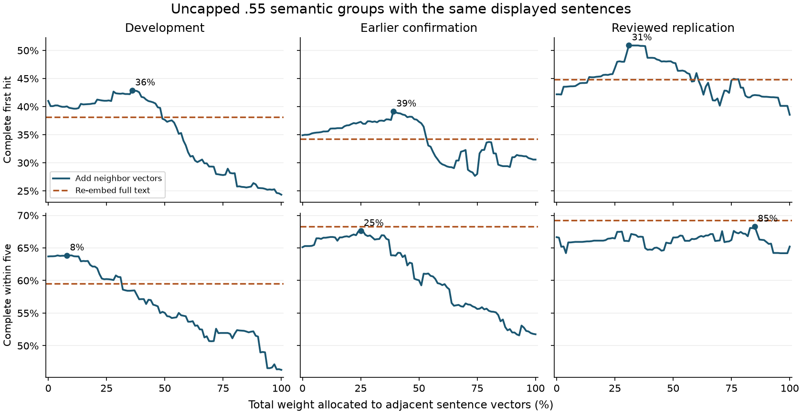

# Paragraphs, sections and how to score neighboring text

**Allow semantic groups to span paragraphs. An explicit heading is a useful stopping point for displayed context.** With the same .25 chunks and search rankings, stopping the displayed neighbors at the section boundary shortened the average first passage from 2,221 to 1,811 nonwhitespace characters. Complete top-five coverage moved from 92.52% to 92.27%. Stopping at each paragraph cost a further 8.38 percentage points. [Boundary results](2026-11-27-scope-weights-scopes.json)

## Which boundaries should hold?

Forming the core and returning neighboring text are separate decisions. The following comparisons used unlimited-size semantic cores, a .25 adjacent-unit similarity cutoff, the mean of the whole-core and best-contained-sentence query scores, and up to one neighboring chunk on either side. Each of seven domains had equal weight. Percentages apply to 484 primary questions from the previous study's 69-document replication set, with the reviewed citations.

| Boundaries respected during formation | Boundaries respected when showing neighbors | Complete first | Complete in five | First-hit citation F1 × 100 | Mean first-hit length |
|---|---|---:|---:|---:|---:|
| Document | Document | 65.3% | 92.5% | 16.1 | 2,221 |
| Document | Paragraph or speaker turn | 59.8% | 83.9% | 22.0 | 1,419 |
| Document | Deepest section | 64.8% | 92.3% | 19.4 | 1,811 |
| Document | Major section | 64.8% | 92.3% | 18.1 | 1,969 |
| Deepest section | Document | 65.3% | 91.8% | 17.8 | 1,762 |
| Deepest section | Deepest section | 64.8% | 91.0% | 25.0 | 1,176 |
| Paragraph or speaker turn | Paragraph or speaker turn | 43.0% | 68.8% | 28.0 | 367 |

A document without an explicit heading has one section. Among the 100 primary questions whose source had multiple identifiable sections, section-clipped display retained 96.8% complete top fives versus 97.1% unrestricted. Mean first-hit length fell from 2,462 to 1,889. The best structural control showed a similar pattern on all 484 questions. Section-clipped neighbors kept 71.4% complete first hits, and top-five coverage moved from 93.1% to 92.6%. A fixed ranking can only lose cited evidence by removing text, but its focus can improve. [Full results and source-paired intervals](2026-11-27-scope-weights-scopes.json)

The exception mattered most in research papers. Limiting only the display lost one complete top five out of 56. The corresponding paper cited two passages for a question about pretrained models besides BERT. Imposing the heading boundary when grouping **and** showing neighbors reduced paper coverage from 52/56 to 46/56. Questions asking for a list of datasets, baselines or metrics can draw evidence from several subsections. In fiction and spoken meetings without explicit headings, the section rule let ordinary paragraphs or speaker turns supply each other's context.

We also allowed a heading crossing when its two edge units reached cosine .40 or .60. On fixed cores, both rules scored 64.8% first and 92.3% in five on replication. The unconditional section stop was simpler and slightly shorter. During core formation the hard stop performed unevenly. Applying it at both stages cost 9.6 points of top-five coverage on development, 1.6 on earlier confirmation, and 1.5 on replication. The development gap was considerably smaller with the .40 exception. These results favor using headings first as a **display preference**. They give less support to making headings irrevocable cuts during chunking. [Soft crossings and the sensitivity excluding finance](2026-11-27-scope-weights-scopes.json)

## Printed lines and real paragraphs

The 29-story problem came from an importer turning single printed newlines into blank paragraphs. Across 804 ordinary source paragraphs from 207 documents, inserting physical newlines at 60, 72 and 90 columns preserved the production parser's normalized units in **2,407/2,412 trials**. In the five exceptions a wrap put a dash or an inline enumeration such as “(4)” at the start of a line. The parser then recognized a list item. Markdown hard breaks, list items, fenced code, tables and genuine paragraph breaks had separate controls. This experiment measures English prose under simulated rewrapping. [Parser probes and exceptions](2026-11-27-scope-weights-wraps.json)

An audit of all 209 current source documents flagged 197 possible continuation breaks across 32 documents. Reading the source distinguished real defects from legitimate structure. In the Johnson & Johnson release, a single bold three-line bullet became three Markdown blocks, two labeled as headings. PepsiCo's two-line title also became two headings. Both were checked against the first printed page. The financial converter classifies individual physical rows before writing Markdown. A government example with similar English syntax was two separate HTML list items in the original source. The 197 flags therefore serve as review candidates. The two PDF defects concern earlier folds; the replication finance documents are shareholder letters. The archived filing inputs retain the conversion artifacts. [Audit candidates](2026-11-27-scope-weights-source-audit.json) · [PDF extraction logic](../financebench-pdf.py) · [Pinned filing sources](2026-11-27-full-filings-data.json)

For document ingestion, retain the distinction between a physical line, a paragraph/list item and an authored section. A layout-aware PDF importer can join a wrapped line to its paragraph or heading before emitting Markdown and retain the contributing source spans for citation. For plain text with unavailable layout, a blank line is evidence of a paragraph. Establishing a section requires stronger evidence. The list examples show why globally joining lowercase continuations would also damage good inputs.

## Adding vectors versus re-embedding

These comparisons used a different operating point, the .55 semantic groups from the original weighting question. Every method ranked the same centers and returned the same window for any given center. The additive key allocated a total weight to the mean of the available left and right sentence vectors, then normalized the sum with the core. The joint key embedded the actual left–core–right text in order.

| Ranking on reviewed replication | Complete first | Complete in five | First-hit citation F1 × 100 |
|---|---:|---:|---:|
| Add neighbor vectors, 30% total | 49.4% | 66.1% | 27.3 |
| Add neighbor vectors, 36% total, development first-hit choice | **50.8%** | 66.7% | 28.3 |
| Re-embed the complete window | 44.8% | **69.2%** | **28.6** |
| Development-selected first-hit three-vector blend¹ | 48.0% | 64.9% | 27.2 |
| Development-selected score blend² | 49.5% | 66.5% | 27.5 |
| Equal reciprocal-rank fusion, constant 10 | 46.7% | 69.1% | 25.8 |

¹ 49% core, 21% neighbor mean and 30% joint vector. ² 65% additive query score, with the neighbor share fixed at 30%, plus 35% joint query score.

The 1% sweep found additive **first-hit** maxima at 36% on development, 39% on earlier confirmation and 31% on reviewed replication. On replication, every weight from 31% through 38% was within one percentage point of its maximum. The prespecified development choice of 36% beat 30% by 1.4 points at rank one, with a paired document-bootstrap 95% interval of −0.2 to +3.0. A working value around one-third is justified for these strict cores. The data cannot reliably distinguish adjacent percentage points. The additive **top-five** maxima moved from 8% to 25% to 85%. Joint re-embedding exceeded the entire additive top-five curve on the two replication folds. Other core sizes gave different preferences. [All weights, endpoint-specific choices and intervals](2026-11-27-scope-weights-weights.json)

The two keys do find different answers. On reviewed replication, the 30% additive and joint keys picked the same first center for only 25.5% of questions on a domain-balanced basis. Additive alone had a complete first hit on 12.4%, and joint alone on 7.8%. An oracle choosing the better of these first hits per question would reach 57.2%. A fixed blend has no such information. The two candidate-key directions had median cosine .81, and different centers can display overlapping evidence. Directly averaging the keys changes which center wins and provides little protection against a highly matched neighbor displacing the answer. Interpolating scores improved over the individual first-hit scores on both earlier folds, but lost to the development-selected additive weight on replication. Alternating the lists recovered 64.4% in five when additive went first. The results establish complementary errors but do not identify a dependable way to choose the better first hit for each question. [Agreement, fusion controls and paired wins/losses](2026-11-27-scope-weights-weights.json)

## What best-sentence scoring returns

At indexing time, embed each chunk and its constituent sentences. At search time, calculate the question's cosine to the chunk and its highest cosine to a sentence entirely inside that chunk. The benchmark weights those two scores equally. A Markdown parser unit can also be a code block or another indivisible element. When a chunk contains no complete unit, its own score is used. The matching sentence helps **rank its parent chunk**. The full parent remains available for display and citation.

For the question “Did they use The Onion as their dataset?”, the general corpus-description chunk had whole-chunk cosine .420 and best-sentence cosine .414, giving it .417. The methods chunk had whole-chunk cosine .392, but its sentence identifying The Onion as the source scored .526. Its combined score of .459 moved it into first place. The returned methods passage was 993 characters. [Worked examples with scores and source identifiers](2026-11-27-scope-weights-examples.json)

The study reran 595 ranking configurations and 91 boundary configurations over 2,049 primary questions and 1,671 separately labeled fiction-section questions. The same seven domains and embedding model were used throughout. Development selected weights, and the prior confirmation and replication documents were already familiar from earlier work. The percentages are domain-balanced rates, and several domains have few fresh sources. This is a benchmark and parser investigation. [Protocol](../scope-weights-protocol.json) · [Verification](2026-11-27-scope-weights-verification.json) · [Reproduction](../README.md#paragraph-and-section-boundaries-and-finer-weights)
